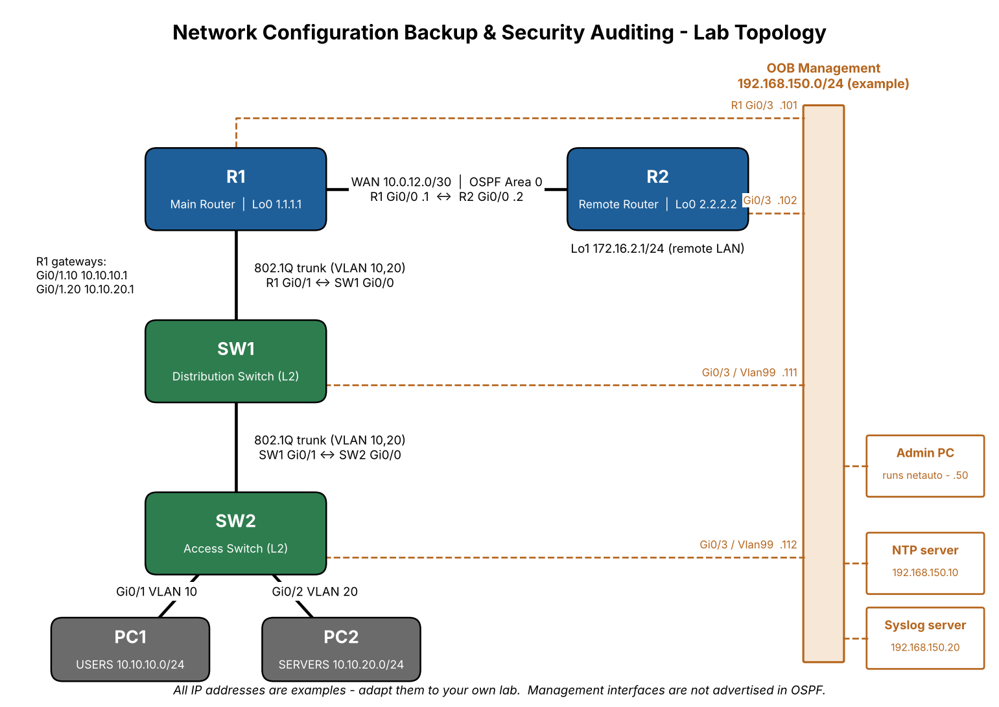

# Network Configuration Backup & Security Auditing Automation

A beginner-friendly **Python + Netmiko** tool that connects to Cisco IOS routers and switches over **SSH**, **backs up** their running configurations (tracked with **Git**), **audits** them against a basic **security policy**, and **verifies** basic network health (interfaces and OSPF).

> Built as an entry-level portfolio project covering Computer Networking, Cisco IOS, Python automation and basic Network Security.



---

## Table of Contents
1. [Introduction](#1-introduction)
2. [Real-World Problem](#2-real-world-problem)
3. [Objectives](#3-objectives)
4. [Network Topology](#4-network-topology)
5. [Technologies Used](#5-technologies-used)
6. [Features](#6-features)
7. [Project Architecture](#7-project-architecture)
8. [Installation](#8-installation)
9. [Configuring the Cisco Devices](#9-configuring-the-cisco-devices)
10. [How to Run Each Command](#10-how-to-run-each-command)
11. [Example Terminal Output](#11-example-terminal-output)
12. [Example Backup File](#12-example-backup-file)
13. [Example Security Audit Report](#13-example-security-audit-report)
14. [Testing](#14-testing)
15. [Limitations and Future Improvements](#15-limitations-and-future-improvements)
16. [Project Status: What Was and Was Not Tested](#16-project-status-what-was-and-was-not-tested)

---

## 1. Introduction

`netauto` is a small command-line tool with four commands:

| Command | What it does |
|---------|--------------|
| `netauto check`  | Logs in to every device over SSH and shows its hostname |
| `netauto backup` | Saves `show running-config` of every device to `R1.cfg`, `R2.cfg`, ... and can commit them to a **private** Git repository |
| `netauto audit`  | Checks the saved configurations against 6 security rules and writes a Markdown report |
| `netauto verify` | Runs `show ip interface brief`, `show ip route`, `show ip ospf neighbor` and reports problems |

## 2. Real-World Problem

In many small and medium networks, engineers still log in to each device by hand to:

- copy configurations before a change (and sometimes forget),
- check whether security settings such as SSHv2 or "no Telnet" are applied everywhere,
- check whether interfaces and routing neighbours are up after a change.

Doing this manually is **slow, repetitive and error-prone**. A missing backup makes recovery from a bad change difficult, and a single device with Telnet enabled can expose passwords in clear text. This project automates these routine tasks with a few simple commands.

## 3. Objectives

1. Connect to Cisco IOS devices securely using SSH (Netmiko).
2. Back up configurations automatically and track changes with Git.
3. Detect basic security misconfigurations and rate them HIGH / MEDIUM / LOW.
4. Verify interface status and OSPF neighbour state.
5. Handle credentials safely - **no passwords in code or in Git**.
6. Keep the code small, readable and covered by unit tests.

## 4. Network Topology

```
                 WAN 10.0.12.0/30 (OSPF area 0)
        R1 Gi0/0 ------------------------------ Gi0/0 R2
        (Main Router)                        (Remote Router)
         Gi0/1  (802.1Q trunk, router-on-a-stick)
          |
        Gi0/0
         SW1  (Distribution switch, Layer 2)
        Gi0/1
          |    (802.1Q trunk, VLAN 10,20)
        Gi0/0
         SW2  (Access switch, Layer 2)
        Gi0/1 -> PC1 VLAN 10      Gi0/2 -> PC2 VLAN 20

  Every device also has an out-of-band management interface (Gi0/3)
  in 192.168.150.0/24, where the Admin PC running netauto lives.
```

| Device | Role | Management IP (example) | Other addressing |
|--------|------|-------------------------|------------------|
| R1  | Main router         | 192.168.150.101 (Gi0/3)  | Gi0/0 10.0.12.1/30, Gi0/1.10 10.10.10.1/24, Gi0/1.20 10.10.20.1/24, Lo0 1.1.1.1 |
| R2  | Remote router       | 192.168.150.102 (Gi0/3)  | Gi0/0 10.0.12.2/30, Lo0 2.2.2.2, Lo1 172.16.2.1/24 |
| SW1 | Distribution switch | 192.168.150.111 (Vlan99) | Trunks to R1 and SW2 |
| SW2 | Access switch       | 192.168.150.112 (Vlan99) | Access ports VLAN 10 / VLAN 20 |

| VLAN | Name | Subnet | Gateway |
|------|------|--------|---------|
| 10  | USERS         | 10.10.10.0/24 | 10.10.10.1 (R1 Gi0/1.10) |
| 20  | SERVERS       | 10.10.20.0/24 | 10.10.20.1 (R1 Gi0/1.20) |
| 99  | MANAGEMENT    | 192.168.150.0/24 (switch SVIs, not trunked) | - |
| 999 | NATIVE_UNUSED | native VLAN on trunks (security best practice) | - |

> **Important:** `192.168.150.0/24` is only an **example** management subnet. Change the addresses in `inventory/devices.yaml` and in the device configurations to match your own lab network.

More detail: [docs/network_topology.md](docs/network_topology.md)

## 5. Technologies Used

| Technology | Why it is used |
|------------|----------------|
| **Python 3** | Main programming language |
| **Cisco IOS** (IOSv / IOSvL2 in GNS3, EVE-NG or CML) | Network devices |
| **Netmiko** | Simple SSH library for network devices |
| **YAML** (PyYAML) | Device inventory and security policy files |
| **Git** | Version history of configuration backups (in a separate private repo) |
| **Pytest** | Unit tests (no real devices needed) |

## 6. Features

**Configuration Backup**
- Runs `show running-config` on every device and saves `R1.cfg`, `R2.cfg`, `SW1.cfg`, `SW2.cfg`.
- Removes lines that change on every run (e.g. `Current configuration : ... bytes`, `! Last configuration change ...`, `ntp clock-period`) so Git shows only real changes.
- Handles timeouts, authentication failures and invalid output, and prints a summary.
- `--commit` commits the backups to a **private** Git repository (skips the commit when nothing changed).

**Security Audit** (`policies/security_policy.yaml`)

| # | Check | Severity |
|---|-------|----------|
| 1 | SSH version 2 is configured (`ip ssh version 2`) | HIGH |
| 2 | Telnet is not allowed on any VTY line | HIGH |
| 3 | No weak `enable password`; `enable secret` is used | HIGH |
| 4 | Remote syslog server configured (`logging host`) | MEDIUM |
| 5 | `service password-encryption` enabled | MEDIUM |
| 6 | NTP server configured | LOW |

Prints PASS/FAIL for every check and writes `reports/security_audit_report.md`.

**Network Verification**
- Shows hostname, interfaces, IP addresses, status, routing table and OSPF neighbours.
- Warns about interfaces that are down (ignores interfaces that are shut down on purpose), OSPF neighbours not in FULL state, routers with no OSPF neighbour, and unreachable devices.

## 7. Project Architecture

```
          +-------------------------+
          |   netauto/main.py (CLI) |   netauto check | backup | audit | verify
          +-----------+-------------+
                      |
    +-----------------+-------------------+-------------------+
    |                 |                   |                   |
 connection.py     backup.py           audit.py            verify.py
 - load inventory  - show run          - read *.cfg        - show ip int brief
 - credentials     - clean + save      - 6 regex checks    - show ip route
 - Netmiko SSH     - git commit        - Markdown report   - show ip ospf neighbor
    |                 |                   |
 inventory/        backups/ (PRIVATE   policies/
 devices.yaml      Git repo)           security_policy.yaml --> reports/
```

```
network-automation-project/
├── netauto/                 Python package
│   ├── __init__.py
│   ├── __main__.py          allows "python -m netauto"
│   ├── main.py              command-line interface (argparse)
│   ├── connection.py        inventory, credentials, SSH (Netmiko)
│   ├── backup.py            configuration backup + git commit
│   ├── audit.py             security checks + Markdown report
│   └── verify.py            interface / routing / OSPF verification
├── inventory/devices.yaml   device list (NO passwords)
├── policies/security_policy.yaml
├── configurations/          sanitized sample IOS configs for R1, R2, SW1, SW2
├── examples/                sample report, backup and terminal output (illustrative)
├── backups/                 real backups go here (ignored by the public repo)
├── reports/                 generated reports (ignored by the public repo)
├── tests/                   pytest unit tests (no devices needed)
├── docs/                    detailed documentation + interview questions
├── diagrams/network_topology.png
├── .env.example             example environment variables (no secrets)
├── .gitignore
├── pyproject.toml           makes the "netauto" command available
├── requirements.txt
├── LICENSE
└── README.md
```

How each module works: [docs/how_it_works.md](docs/how_it_works.md)

## 8. Installation

Requirements: Python 3.8+ and Git. Full guide: [docs/installation_guide.md](docs/installation_guide.md)

```bash
git clone https://github.com/<your-username>/network-automation-project.git
cd network-automation-project

python -m venv venv
source venv/Scripts/activate      # Git Bash on Windows
# source venv/bin/activate        # Linux / macOS

pip install -r requirements.txt
pip install -e .                  # creates the "netauto" command
netauto --help
```

If you do not want to install the package, use `python -m netauto <command>` instead of `netauto <command>`.

## 9. Configuring the Cisco Devices

1. Build the topology in **GNS3, EVE-NG or Cisco CML** using IOSv (routers) and IOSvL2 (switches). Cisco Packet Tracer cannot be used because Python cannot SSH into Packet Tracer devices.
2. Connect every device's **Gi0/3** to the management network (for example a GNS3 *Cloud* / host-only adapter in 192.168.150.0/24).
3. Open each file in `configurations/`, replace every `CHANGE_ME_...` value with your own lab password, and paste it into the device console in `configure terminal` mode.
4. Save with `copy running-config startup-config`.
5. From your PC test: `ping 192.168.150.101` and `ssh netadmin@192.168.150.101`.

Step-by-step guide with verification commands: [docs/configuration_guide.md](docs/configuration_guide.md)

## 10. How to Run Each Command

Credentials are **never** stored in the code. `netauto` reads them from environment variables or asks for them (the password is hidden while typing):

```bash
export NETAUTO_USERNAME=netadmin        # optional - otherwise you are prompted
# NETAUTO_PASSWORD / NETAUTO_ENABLE_SECRET are optional; prompting is safer
```

```bash
netauto --help                        # list all commands
netauto check                         # test SSH login to all devices
netauto backup                        # save configs to backups/
netauto backup --commit               # save + commit to the private Git repo
netauto backup --backup-dir ~/netauto-config-backups --commit
netauto audit                         # audit the latest backups in backups/
netauto audit --config-dir configurations   # audit the sample configs (no lab needed)
netauto verify                        # interface + OSPF health check
```

Exit codes: `0` = everything OK, `1` = at least one device failed / check failed, `2` = input file error.

### Keeping backups in a private Git repository

Real configurations contain password hashes, IP addresses and topology details, so **they must never go to a public repository**. Keep them in a separate local repository:

```bash
mkdir -p ~/netauto-config-backups
cd ~/netauto-config-backups
git init
git config user.name  "Your Name"
git config user.email "you@example.com"
cd -   # back to the project
netauto backup --backup-dir ~/netauto-config-backups --commit
git -C ~/netauto-config-backups log --oneline       # history of backups
git -C ~/netauto-config-backups diff HEAD~1 -- R1.cfg   # what changed on R1
```

(You can also `git init` inside the project's `backups/` folder - the public repository ignores its contents through `.gitignore`.)

## 11. Example Terminal Output

> The output below was produced by actually running `netauto` - but against a **local SSH simulator** that imitates Cisco IOS, **not** real Cisco devices (that is why the host is `127.0.0.1`). Full captured output: [examples/sample_terminal_output.md](examples/sample_terminal_output.md)

```text
$ netauto check
SSH username: netadmin
SSH password:
Enable secret (press Enter to skip):

Checking SSH connectivity to 4 device(s)...

  [OK]   R1    127.0.0.1         hostname: R1
  [OK]   R2    127.0.0.1         hostname: R2
  [OK]   SW1   127.0.0.1         hostname: SW1
  [OK]   SW2   127.0.0.1         hostname: SW2

4/4 device(s) reachable via SSH.
```

Failure handling (real Netmiko errors, captured in this environment):

```text
  [FAIL] R1 (192.168.150.101): connection timed out - check the IP address, reachability and that SSH is enabled
  [FAIL] R1 (127.0.0.1): authentication failed - check the username and password
```

`netauto verify` (excerpt, simulator with SW2 Gi0/2 deliberately down):

```text
==================== R1 (router) ====================
  Interfaces:
    Interface               IP Address        Status                  Protocol
    GigabitEthernet0/0      10.0.12.1         up                      up
    GigabitEthernet0/2      unassigned        administratively down   down
    ...
  OSPF neighbours:
    2.2.2.2         FULL      10.0.12.2       GigabitEthernet0/0

  Health:
    [OK] No problems found

==================== SW2 (switch) ====================
  ...
  Health:
    [WARN] Interface GigabitEthernet0/2 is down/down

========== Verification Summary ==========
Healthy devices      : 3/4
  SW2: 1 problem(s)
```

`netauto audit` on the deliberately insecure example (real output):

```text
=== insecure_router_example ===
  [FAIL] [HIGH  ] SSH version 2 must be configured
         -> 'ip ssh version 2' is missing (SSHv1 is insecure)
  [FAIL] [HIGH  ] Telnet must not be enabled on VTY lines
         -> line vty 0 4: 'transport input telnet ssh' allows Telnet; line vty 5 15: no 'transport input' (default may allow Telnet)
  [FAIL] [HIGH  ] Weak enable password must not be configured
         -> 'enable password' is configured (stored in plain text or weak type 7)
  [FAIL] [MEDIUM] Remote logging (syslog) must be configured
         -> No 'logging host <ip>' configured
  [FAIL] [MEDIUM] Password encryption service must be enabled
         -> 'no service password-encryption' is configured
  [FAIL] [LOW   ] NTP server must be configured
         -> No 'ntp server' configured

Audit complete: 0/6 checks passed, 6 failed.
```

## 12. Example Backup File

`backups/R1.cfg` after `netauto backup` (volatile header lines removed; hashes are fake). Full file: [examples/sample_backup_R1.cfg](examples/sample_backup_R1.cfg)

```text
!
version 15.9
!
hostname R1
!
service timestamps debug datetime msec
service timestamps log datetime msec
service password-encryption
!
enable secret 9 $9$SIMULATEDHASH
username netadmin privilege 15 secret 9 $9$SIMULATEDHASH
!
ip ssh version 2
...
```

## 13. Example Security Audit Report

> Illustrative report generated by running `netauto audit` on the sample configurations plus one deliberately insecure example. Full report: [examples/sample_security_audit_report.md](examples/sample_security_audit_report.md)

| Device | Passed | Failed | HIGH | MEDIUM | LOW |
|--------|--------|--------|------|--------|-----|
| LEGACY-RTR | 0 | 6 | 3 | 2 | 1 |
| R1 | 6 | 0 | 0 | 0 | 0 |
| R2 | 6 | 0 | 0 | 0 | 0 |
| SW1 | 6 | 0 | 0 | 0 | 0 |
| SW2 | 6 | 0 | 0 | 0 | 0 |

Findings are listed by severity with the fix, e.g.:

- **[HIGH] LEGACY-RTR - Telnet must not be enabled on VTY lines**: line vty 0 4: 'transport input telnet ssh' allows Telnet
  - Fix: `line vty 0 4 -> transport input ssh`

## 14. Testing

```bash
pytest -v
```

The tests use **mocked SSH connections and sample text**, so no Cisco device is needed. They cover:
- audit detects missing SSHv2, Telnet (`telnet`, `all`, or no `transport input`), weak enable password, missing NTP / logging / password encryption,
- audit passes a compliant configuration and all four sample lab configs,
- backup saves the configuration with a mocked Netmiko connection, cleans volatile lines, handles authentication failure and invalid output, and commits to a Git repo only when something changed,
- Netmiko timeout / authentication exceptions are converted into friendly errors,
- verification parsers for `show ip interface brief`, `show ip route` and `show ip ospf neighbor`.

## 15. Limitations and Future Improvements

**Limitations**
- Supports Cisco IOS / IOS-XE style output only (`cisco_ios` driver).
- Audit checks are simple text / regex checks on 6 rules; a PASS does not mean the device is fully secure.
- Output parsing uses simple string splitting and may need small changes for other IOS versions.
- Devices are processed one at a time (fine for a small lab, slow for hundreds of devices).
- `verify` assumes switches are Layer 2 (no OSPF on switches).

**Possible future improvements (kept out on purpose to keep the project simple)**
- More audit rules (VTY ACL, exec-timeout, banner, unused ports shut down, SNMP community strings).
- Scheduling backups with Windows Task Scheduler or cron.
- Parallel connections with threads for larger networks.
- Exporting the audit report to HTML or CSV.

## 16. Project Status: What Was and Was Not Tested

| Item | Status |
|------|--------|
| Python syntax of all modules | Verified (`py_compile`) |
| Unit tests (`pytest`) | Executed - all passing |
| CLI `--help`, `audit` on sample and insecure configs | Executed |
| `check`, `backup --commit`, `verify` | Executed against a **local SSH simulator** (Python/Paramiko), plus real timeout / wrong-password error paths |
| Cisco IOS configurations in `configurations/` | **Lab-ready, not verified on real hardware or a live emulator** |
| Running against real IOSv / IOSvL2 in GNS3 / EVE-NG / CML | **Not yet tested - to be done in your virtual lab** |

## License

MIT - see [LICENSE](LICENSE).
