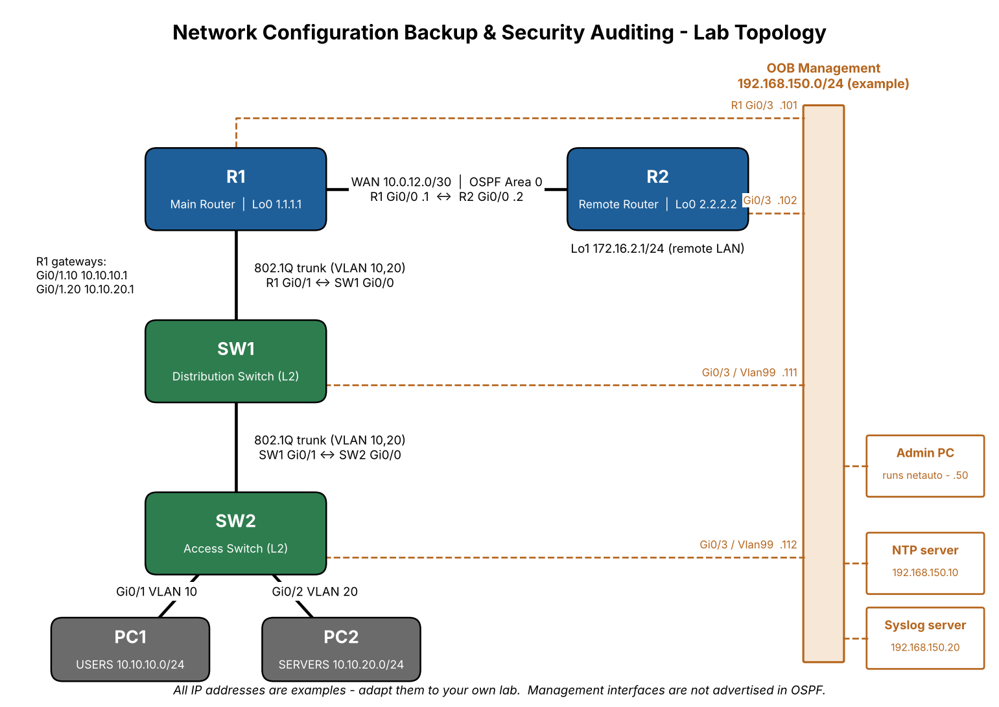

# Network Topology



## Logical layout

```
R1 ---- R2
|
SW1
|
SW2
```

- **R1 (Main Router)** connects to the remote router R2 over a point-to-point WAN link, and to SW1 through an 802.1Q trunk. R1 is the default gateway for VLAN 10 and VLAN 20 (router-on-a-stick).
- **R2 (Remote Router)** represents a branch site. Its Loopback1 simulates the remote LAN 172.16.2.0/24.
- **SW1 (Distribution Switch)** carries VLAN 10 and 20 between R1 and SW2.
- **SW2 (Access Switch)** connects end users: PC1 in VLAN 10 and PC2 in VLAN 20.

## Management network (out-of-band)

All four devices have a dedicated management interface (Gi0/3) connected to the example management subnet **192.168.150.0/24**. The PC that runs `netauto` is also in this subnet.

| Device | Interface | Management IP |
|--------|-----------|---------------|
| R1  | Gi0/3 | 192.168.150.101/24 |
| R2  | Gi0/3 | 192.168.150.102/24 |
| SW1 | Vlan99 (access port Gi0/3) | 192.168.150.111/24 |
| SW2 | Vlan99 (access port Gi0/3) | 192.168.150.112/24 |
| Admin PC (netauto) | - | 192.168.150.50 (example) |
| NTP server | - | 192.168.150.10 (example) |
| Syslog server | - | 192.168.150.20 (example) |
| Lab gateway | - | 192.168.150.1 (example) |

Why out-of-band? Using a separate management network means you can still reach the devices with SSH even if OSPF or a trunk is broken. The management interfaces are **not** advertised into OSPF, and VLAN 99 is **not** allowed on the trunks (otherwise the two switches would be bridged through both the trunk and the management cloud, creating a loop).

> **Adapt the addresses:** 192.168.150.0/24 is an example. In GNS3 it is common to connect Gi0/3 to a *Cloud* node bound to a host-only / loopback adapter - use whatever subnet that adapter has, and update `inventory/devices.yaml` and the configuration files to match.

## Data-plane IP plan

| Link / Network | Subnet | Addresses |
|----------------|--------|-----------|
| R1 - R2 WAN | 10.0.12.0/30 | R1 Gi0/0 .1, R2 Gi0/0 .2 |
| VLAN 10 USERS | 10.10.10.0/24 | Gateway R1 Gi0/1.10 = 10.10.10.1 |
| VLAN 20 SERVERS | 10.10.20.0/24 | Gateway R1 Gi0/1.20 = 10.10.20.1 |
| R1 Loopback0 | 1.1.1.1/32 | OSPF router-id |
| R2 Loopback0 | 2.2.2.2/32 | OSPF router-id |
| R2 Loopback1 | 172.16.2.0/24 | Simulated remote LAN |

## Physical cabling

| From | To | Purpose |
|------|----|---------|
| R1 Gi0/0 | R2 Gi0/0 | WAN / OSPF |
| R1 Gi0/1 | SW1 Gi0/0 | 802.1Q trunk (VLAN 10, 20) |
| SW1 Gi0/1 | SW2 Gi0/0 | 802.1Q trunk (VLAN 10, 20) |
| SW2 Gi0/1 | PC1 | Access VLAN 10 |
| SW2 Gi0/2 | PC2 | Access VLAN 20 |
| R1/R2/SW1/SW2 Gi0/3 | Management cloud / switch | Out-of-band management |

## VLANs

| VLAN | Name | Used for |
|------|------|----------|
| 10  | USERS | User PCs |
| 20  | SERVERS | Servers |
| 99  | MANAGEMENT | Switch management SVI (local only, not trunked) |
| 999 | NATIVE_UNUSED | Native VLAN on trunks - unused, protects against VLAN hopping |

## OSPF

- Process 1, single **area 0**.
- `passive-interface default`, with only Gi0/0 (WAN) active, so OSPF hellos are not sent toward user VLANs.
- The WAN link uses `ip ospf network point-to-point`, so there is no DR/BDR election and the neighbour state shows `FULL/  -`.
- Expected result: R1 learns 2.2.2.2/32 and 172.16.2.0/24; R2 learns 1.1.1.1/32, 10.10.10.0/24 and 10.10.20.0/24.

## Status

This topology and the configurations are **designed for** Cisco IOSv / IOSvL2 in GNS3, EVE-NG or Cisco CML. They have **not** been verified on physical hardware. Interface names may differ on other images (for example, GigabitEthernet1 on CSR1000v).
